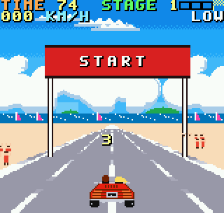

# SUNSET RUN

Un arcade de carretera al estilo de **OutRun** para **Neo Geo Pocket Color**:
contrarreloj con checkpoints, cinco etapas con bifurcaciones (15 tramos y 5 metas),
tráfico, radio con tres temas originales y el clásico "elige izquierda o derecha".

Proyecto homebrew, gratuito y de código abierto. No está afiliado a SEGA; nombre,
gráficos y música son originales.



## Jugar

Carga `bin/sunsetrun.ngc` en un emulador de NGPC (Mednafen, RACE, NeoPop…) o en una
flashcart.

| Botón | Carrera | Título |
|---|---|---|
| A | Acelerar | Empezar |
| B | Frenar | En modo FREE: nueva semilla |
| Izquierda / Derecha | Girar | Cambiar emisora de radio (la última, SILENCIO, deja solo el motor) |
| Arriba / Abajo | Marcha LOW / HIGH | Elegir modo: EASY, NORMAL, HARD, FREE |
| OPTION | Pausa | – |

* Cambio de dos marchas, como el arcade: **LOW** acelera muy rápido hasta unos 180 km/h;
  **HIGH** llega a la velocidad máxima (~290 km/h) pero por debajo de 180 km/h acelera
  muy despacio. Sal en LOW y pasa a HIGH al acercarte a 180: el indicador LOW
  parpadea en rojo para recordártelo.
* Hay curvas suaves que se toman a fondo, curvas cerradas y curvas en S. Las cerradas
  se anuncian con señales de flecha en el arcén; si entras demasiado rápido las ruedas
  derrapan (humo blanco y chirrido) y la fuerza centrífuga te saca hacia el exterior,
  contra las palmeras, rocas o señales. Levanta el pie o frena.
* Al elegir bifurcación, el siguiente tramo empieza con una curva hacia ese lado.
* Cada checkpoint suma tiempo (*EXTENDED PLAY*). El tiempo depende del modo (abajo).
* Al final de cada tramo la carretera se bifurca: las señales y el aviso en
  pantalla marcan la elección. Mantente a la **izquierda o a la derecha** del carril central
  antes de llegar al final; la elección se fija unos metros antes del cruce.
* **Tráfico**: si tocas otro coche no chocas: te empuja hacia un lado (de unos 30 px
  despacio a unos 110 px a tope), derrapas con humo, chirrían las ruedas un instante
  después del golpe, el coche culea y te quedas con menos de la mitad de la velocidad
  (y puedes acabar en el arcén).
* **Arcén** (palmeras, rocas, señales, pilares de los puentes): a poca velocidad te frena;
  por encima de unos 145 km/h el coche trompea; desde 220 km/h **vuelca de lado**
  (vuelta de campana viendo los bajos) y desde 280 km/h da una **vuelta hacia
  delante**, de morro, enseñando los bajos y las ruedas. Cuenta la velocidad con la que
  saliste del asfalto. La arena / hierba te frena.
* En el campo, el otoño, la granja, el lago y las ruinas la carretera pasa bajo una
  larga serie de **puentes de piedra** (unos 10 s a tope): primero en recta, luego en
  bajada, en subida y por último en curva. A lo lejos se ven finos y van engordando al
  acercarse. Sus pilares están fuera del asfalto, pero si vas
  por el arcén te los comes.
* Al terminar (en la meta o sin tiempo) aparece el **mapa del recorrido**: la pirámide
  de tramos con una miniatura de cada paisaje y un cochecito rojo que recorre las
  bifurcaciones que has tomado, hasta la meta o hasta donde se acabó el tiempo
  (A lo salta). Después, la pantalla de resultados.
* La puntuación sube con la velocidad; al llegar a la meta el tiempo sobrante da bonus.

## Modos de juego

Se eligen en la pantalla de título con Arriba / Abajo. Cada modo tiene su propio
récord, y el color de las pancartas START y FINISH indica el modo.

| Modo | Tiempo | Tráfico | Pancarta |
|---|---|---|---|
| EASY | 74 s de salida; +58, +56, +54, +52 en los checkpoints | normal | verde, letras blancas |
| NORMAL | 3 s menos por etapa (71; +55, +53, +51, +49) | normal | blanca, letras rojas |
| HARD | como NORMAL | más coches, más lentos y que cambian de carril más a menudo | roja, letras blancas |
| FREE | calculado para cada tramo según su longitud y sus curvas, al nivel de NORMAL | normal | azul, letras blancas |

**FREE**: la pirámide de 15 tramos se mantiene, pero los paisajes se reparten al azar y
cada tramo (rectas, curvas, curvas en S, cuestas) se construye en el momento a partir
de una **semilla** de 4 cifras hexadecimales que se ve en el título (y en la pantalla
final). La misma semilla da siempre el mismo viaje: si un recorrido te gusta, vuelve a
jugarlo o pásale la semilla a otra persona. B en el título genera una nueva. Las metas
de FREE tienen su propio final (*JOURNEY COMPLETE*).

## Récords guardados

Los récords de los cuatro modos, el último modo, la emisora y la semilla se guardan
en la memoria flash del cartucho (en un emulador, en su fichero de partida guardada).
Se escribe solo al cambiar de pantalla (al empezar una carrera o al volver al título),
con el driver de guardado de dos bancos de NgpCraft. La ROM ocupa 512 KB porque incluye
el espacio de guardado de un cartucho de 4 Mbit.

## Mapa de rutas (EASY, NORMAL y HARD)

15 escenarios distintos en pirámide y 5 metas, cada una con su final:

```
Etapa 1:                        PLAYA
Etapa 2:                  COSTA       ALPES
Etapa 3:            CIUDAD     DESIERTO     CAMPOS
Etapa 4:       OTOÑO      CUEVAS      NIEVE      GRANJA
Etapa 5:  AUTOPISTA   CAÑÓN       LAGO      PUEBLO COSTERO   RUINAS
             (A)       (B)        (C)            (D)          (E)
```

| Meta | Final | Trofeo | Celebración |
|---|---|---|---|
| A | AUTOBAHN ACE | plata | confeti |
| B | CANYON CONQUEROR | bronce | fuegos artificiales |
| C | LAKESIDE DREAM | cristal | globos |
| D | SEASIDE PARTY | oro | estrellas |
| E | LEGEND OF THE RUIN | rubí | fuegos artificiales |

## Compilar

### Windows (recomendado)

1. Instala **Python 3** desde https://www.python.org/downloads/ (marca la casilla
   *Add python.exe to PATH*).
2. Descarga el ensamblador **AS** para Windows
   (http://john.ccac.rwth-aachen.de:8000/ftp/as/precompiled/i386-unknown-win32/aswcurr.zip)
   y descomprímelo dentro de la carpeta `tools\win\`.
3. Haz doble clic en **`build.bat`**. La primera vez instala solo `pycparser` y
   `pillow`. La ROM queda en `bin\sunsetrun.ngc`.

No hace falta gcc ni nada más: el compilador de C (`tools/c900`) y su
preprocesador están escritos en Python.

### Linux / macOS

`python3 tools/build.py` (o `./build_open.sh`), con `asl` y `p2bin` en el PATH,
en `tools/asl/` o indicados con las variables `ASL` y `P2BIN`
(https://github.com/Macroassembler-AS/asl-releases).

### Detalles

`tools/c900/` es un compilador C89 → TLCS-900/H escrito para este proyecto (sobre
`pycparser`) que genera ensamblador para el Macroassembler AS. Se validó con miles
de expresiones aleatorias comparadas contra gcc (`tools/c900/fuzz.py`), ejecutando
el motor de OVER REV (idéntico al ROM oficial fotograma a fotograma) y el driver de
sonido. El preprocesador en Python (`tools/c900/cpp.py`) produce exactamente los
mismos tokens que `gcc -E` en todos los ficheros del juego, y la ROM sale idéntica
byte a byte. El camino oficial de Toshiba (cc900, `python build.py --thome ...`)
sigue disponible si tienes ese SDK.

## Estructura

| Ruta | Contenido |
|---|---|
| `src/main.c` | Bucle de juego, estados (título, cuenta atrás, carrera, meta, resultados), modos, guardado |
| `src/course.c` | Mapa de rutas, bifurcaciones, buffer de tramos y generador del modo FREE |
| `src/core/ngpc_flash*` | Guardado en flash (NgpCraft, MIT) |
| `src/traffic.c` | Tráfico: aparición, carriles, proyección y colisiones |
| `src/theme.c` | Panorama, colores de carretera y objetos de cada tramo |
| `src/id_scenery.c` | Objetos de arcén, señales de bifurcación y banderas |
| `src/bridge.c` | Puentes de piedra (SCR1 en perspectiva, colisión con los pilares) |
| `src/hud.c` | Marcadores (tiempo, etapa, barra de progreso, velocidad y cambio, arriba) |
| `src/game_audio.c`, `src/audio/player.c` | Música y efectos (reproductor PSG ligero) |
| `src/spr_cells_asm.asm` | Escritura de sprites en ensamblador (coche, tráfico, objetos) |
| `src/id_road*`, `src/driving.inc`, `src/core`, `src/fx`, `src/gfx` | Motor de OVER REV / NgpCraft (MIT) |
| `tools/art.py`, `tools/pano.py` | Arte original (sprites como texto, panoramas procedurales) |
| `tools/gen_gfx.py` | PNG/arte → tiles, paletas y mapas NGPC (`GraphX/`) |
| `tools/gen_course.py` | Genera los 15 tramos fijos y la tabla de paisajes (el modo FREE usa las mismas reglas en `course.c`) |
| `tools/gen_title.py` | Pantalla de título |
| `tools/gen_map.py` | Mapa del recorrido (fondo y miniaturas sacadas de los panoramas) |
| `tools/gen_music.py` | Partituras originales → streams del driver de sonido |
| `tools/objart.py` | Objetos del arcén dibujados por código (palmeras, molinos, árboles, columnas, señales) |
| `media/` | GIF de juego, grabaciones de las tres canciones y una carrera con el motor |
| `tools/classical.py`, `tools/lyparse.py`, `music/classical/` | Radio: partituras de dominio público y su arreglo |

### Personalizar

* **Tramos**: `tools/gen_course.py` (longitud, estilo de curvas por tema, tráfico).
* **Tiempos**: `stage_time[][]` en `src/main.c` (EASY y NORMAL/HARD por etapa).
* **Pantalla de título**: `tools/gen_title.py` (emblema, palmera y rótulo, dibujados por código).
* **Gráficos**: los sprites son rejillas de texto en `tools/art.py`; los fondos se
  dibujan en `tools/pano.py`. Si prefieres dibujar PNGs, `tools/conv.py`
  (`convert_plane`) convierte cualquier imagen 256×88 a tiles con ≤8 paletas.
* **Música**: copia archivos MIDI en `music/` y compila (instrucciones en
  `music/LEEME.txt`); sin MIDIs se usan los temas escritos en `tools/gen_music.py`
  (notación sencilla: `C5/4` = do5 negra). El conversor es `tools/midi.py`.

## Estado y límites conocidos

* La lógica del juego va en tiempo real aunque la máquina no llegue a 30 imágenes por
  segundo: si un fotograma tarda más, el coche, el tráfico y el reloj se ponen al día
  (hasta 3 pasos por imagen). En un emulador lento se verá menos fluido, pero no más lento.

* Probado en emulador (Mednafen/Beetle NGP) con un piloto automático de pruebas
  (`-D AUTOPILOT=1`) que recorre las cinco etapas hasta la meta. **No probado aún en
  hardware real.**
* La carretera es más ancha que la pantalla (como en el arcade). El mapa de fondo de la
  NGPC solo mide 256 px, así que las filas cercanas se guardan tres veces (centrada y
  desplazada a cada lado) y el raster elige cuál mostrar en cada línea (`wide_rows()` en
  `src/id_road.c`, generado por `tools/gen_gfx.py`).
* La bifurcación se representa con señales y el HUD; la carretera no se divide
  visualmente en dos.
* Guardado de récords probado en emulador (Beetle NGP). En ese emulador el borrado de
  bloques flash no está emulado: tras unas 60 grabaciones (cada nuevo récord o cambio
  de opciones) dejaría de guardar, y se conservaría el último récord grabado. En
  hardware y en emuladores que emulan el borrado no hay ese límite.

## Arte y sonido

Segunda pasada de arte y sonido, inspirada en el estilo de las recreativas de
carreras de mediados de los 80 tras estudiar su paleta, sus composiciones y su
música (tempo, tonalidades, instrumentación). No contiene gráficos, melodías ni
sonidos de ningún juego comercial: todo se genera con los scripts de `tools/`.

* Fondos: cielos pastel con degradado tramado, un banco de cúmulos sobre el mar,
  montañas con trazos verticales de luz y sombra, molinos, copas otoñales, lago con
  islotes y un pueblo antiguo al atardecer.
* Carretera de 4 carriles en gris claro; el horizonte coincide con su punto de fuga.
* Coche con la zaga de lamas y pilotos, el chico castaño a la izquierda y la chica
  rubia a la derecha; tráfico en colores vivos (morado, amarillo, rosa, verde, celeste).
* Música: Scott Joplin, el rey del ragtime (todas sus obras son de dominio público),
  en arreglos chiptune sacados de las partituras para piano del Mutopia Project
  (`music/classical/`, ver su LEEME). Emisoras: **THE ENTERTAINER** (1902, 3:18),
  **MAPLE LEAF RAG** (1899, 3:02), **PINE APPLE RAG** (1908, 3:05) y **PEACHERINE RAG**
  (1901, 3:05), más SILENCIO. Al acabarse el tiempo y en los resultados suena **Solace**
  (1909), su serenata lenta. Melodía, bajo, armonía y batería salen de la partitura
  (`tools/lyparse.py` lee LilyPond, `tools/classical.py` hace el arreglo); en la meta,
  la fanfarria. Hay grabaciones en `media/`.
* Salida con pancarta START y público animando con ropa de colores (rojo, azul, verde),
  que suelta globos al dar la salida; meta con pancarta FINISH, público y
  trofeo en la pantalla final.
* Pantalla de título azul con un emblema ovalado: puesta de sol sobre el mar, una
  carretera hacia el sol, palmera, el rótulo SUNSET RUN inclinado y el descapotable
  levantando arena.
* Nubes de la playa separadas y modeladas (luz arriba, sombra en la base de cada bola).
* El fondo se desplaza en una sola capa al girar (antes la franja alta iba más lenta y
  las cimas se separaban de la montaña); detrás de los marcadores hay una franja de
  cielo liso.
* Vuelco: 12 fotogramas generados girando la vista trasera del coche (girar la vista
  trasera es justo lo que se ve en una vuelta de campana); los fotogramas boca abajo
  muestran los bajos. La vuelta hacia delante proyecta las caras del coche (trasera,
  bajos con las ruedas, frontal boca abajo y techo) para cada ángulo. Usan los
  caracteres del coche mientras dura.
* Cuevas: montañas rocosas escarpadas al atardecer (agujas de roca de perfil irregular
  con la cara al sol y la de sombra, vetas y grietas, una cordillera violeta detrás y
  pinos al pie).
* Playa: dos grandes torres de cúmulos sobre el mar.
* Los panoramas usan 13 paletas (la carretera solo necesita una).
* Motor: una nota grave en el canal 3 del PSG que sube con las revoluciones y baja
  al pasar a HIGH. Pitidos de salida, campana de checkpoint y chirrido de neumáticos.

## Créditos y licencias

* Motor de carretera, física y núcleo: OVER REV engine template / NgpCraft
  (Tixul, licencia MIT, ver `LICENSE`).
* Reproductor de música propio (`src/audio/player.c`); el pequeño programa Z80 que vuelca
  los comandos al PSG procede de NGPC_sound_driver_custom (NgpCraft, MIT).
* Fuente de texto: fuente "dash" de OVER REV (MIT), con sombra añadida.
* Juego, gráficos, arreglos, toolchain abierta: este proyecto, MIT.
* Música: obras de Scott Joplin (dominio público), a partir de ediciones del Mutopia
  Project puestas en el dominio público por sus transcriptores (ver
  `music/classical/LEEME.txt`).
* Mecánicas inspiradas en OutRun (SEGA, 1986). Referencias de jugabilidad
  consultadas en Cannonball (djyt); no se ha copiado su código ni datos.
